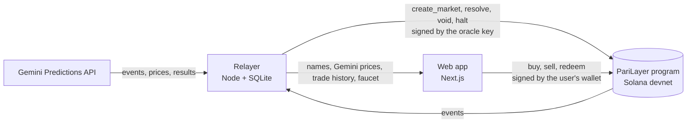

# PariLayer

A dynamic parimutuel wagering market on Solana devnet where **a share costs at most 1 USDC and a
winning share pays at least 1 USDC, whatever happens after you buy.**

It prices outcomes with Pennock's dynamic parimutuel market maker (cost function
C(q) = ‖q‖₂), opens every market at Gemini Predictions' prices, settles on
Gemini's results, and lets holders sell back to the pool at any time while a
market is open.

Built for UBC 2026, Track 02 (DeFi & Onchain Apps).

- **Try it:** https://parilayer.vercel.app (relayer API: https://parilayer-relayer.fly.dev). Pick "Burner wallet" (no install), then "Get test USDC" in the wallet menu.
- **How the guarantee works:** the How it works page, or [PROGRAM_WALKTHROUGH.md](PROGRAM_WALKTHROUGH.md) for the program itself.
- **Tests:** the program re-checks its invariants on-chain after every trade, and property tests run thousands of random trades against them; [PROGRAM_WALKTHROUGH.md](PROGRAM_WALKTHROUGH.md) maps each one to its tests.

## What it does

| | |
| --- | --- |
| **Markets** | Binary (one Gemini contract), multi-outcome (a Gemini event whose contracts are mutually exclusive, up to 32 outcomes) and pair pools (two Gemini contracts, four joint outcomes). |
| **Buy** | USDC in, shares out. The pool price is at most 1 USDC a share, before a 1% fee to the treasury. Your floor is fixed when you buy: shares × 1 USDC if you are right. |
| **Sell back** | Shares in, USDC out, along the same curve: you get what your shares added to the pool, minus a 2% fee that stays in the pot for the remaining holders. Buying and immediately selling costs exactly the two fees. |
| **Gemini side by side** | Every market page shows the pool's odds next to Gemini's and flags a gap over 5 points. |
| **Settlement** | When Gemini settles, the relayer posts the result on-chain and logs Gemini's response and its hash. Winners redeem from the portfolio page. |
| **Pair builder** | Pick two contracts; see the four joint outcomes priced by the pool, the product of the legs, and Gemini's own combo price when one exists. A pair's pool is created by its first buy. |

## Why a winning share pays at least 1 USDC

qᵢ is the number of shares of outcome i, N = ‖q‖ = √(Σ qⱼ²), and M is the pot.

- A share of i costs qᵢ / N, which is at most 1 because no single qᵢ is longer than the whole vector.
- The pot always holds at least C(q) = N. Every buy adds at least the cost increase; every sell takes out less than the cost decrease; every rounding goes against the trader.
- If i wins, each of its shares gets M / qᵢ ≥ N / qᵢ ≥ 1.

The program checks M ≥ C(q) after every instruction. Against a plain
parimutuel pot, the difference shows when late money floods your outcome: the
parimutuel payout is diluted toward break-even (and below, after fees), while
the pool's payout stops at your floor. `cargo run -p parilayer-math --example simulate`
prints the comparison; the How it works page charts it.

The probability shown for each outcome is the current value of its shares
divided by the pot, qᵢ² / N², not the share of money bet on it.

## Architecture



| Path | What |
| --- | --- |
| `crates/parilayer-math` | Pure integer pool math, property tests, the golden-vector generator and the floor simulation |
| `programs/parilayer` | The Anchor program and its LiteSVM integration tests |
| `packages/sdk` | Shared TypeScript: IDL, PDAs, instruction builders, and a BigInt port of the math checked against the Rust crate |
| `relayer` | Mirrors Gemini events as markets, posts results, serves reference prices, indexes trades, runs the devnet faucet and pair creation |
| `web` | The frontend: markets, market page, buy/sell slip, portfolio, pair builder, How it works |
| `rfq` | A prototype trader-to-trader market (private request-for-quote with atomic settlement). Not used by this build; see Roadmap |

Only the relayer talks to Gemini. Every dollar sits in token accounts owned by
the program, and every trade is signed by the trader's own wallet.

## Trust assumptions

- **The relayer is a trusted oracle.** Its key creates markets at Gemini's prices, halts trading when Gemini does, and posts Gemini's results. A dishonest relayer could post a wrong result. It cannot move anyone's funds: no instruction lets the oracle withdraw from a pot. Every result it posts is logged with the full Gemini response and its SHA-256 (`relayer/data/audit.jsonl`).
- **The admin key** can change the oracle and the fees (each capped at 10%), and can sweep a settled market's leftover dust to the treasury after every claim is paid or after 30 days.
- **Devnet only.** USDC here is a mock 6-decimal token minted by the admin for testing; it has no value.
- **Gemini is the source of truth** for prices at creation and for results. Where Gemini's docs are silent, two rules apply. An event becomes one multi-outcome market only when it is configured as mutually exclusive and its Yes prices sum to about 100%; otherwise each contract is its own yes/no market. A contract Gemini marks `invalid`, or settles without a side, is treated as void, and every share redeems at its final pool price.

## Run it locally

Needs Rust, the Solana CLI 4.x, Anchor 1.2.x and Node 22.

```sh
npm install
anchor build
anchor test                       # the program's tests (math + LiteSVM integration)
npm test                          # SDK, relayer and RFQ prototype tests

./scripts/local-validator.sh      # terminal 1: a local validator with the program loaded
GEMINI_MOCK=1 ./scripts/local-setup.sh   # terminal 2: mock USDC, treasury, markets from recorded Gemini data
SOLANA_RPC_URL=http://127.0.0.1:8899 RELAYER_DATA_DIR=relayer/data-local GEMINI_MOCK=1 npm run serve -w relayer
NEXT_PUBLIC_RPC_URL=http://127.0.0.1:8899 npm run dev -w web     # http://localhost:3000
```

Keys live in `keys/` (git-ignored) and are loaded by path. `npm run demo -w relayer`
generates realistic trading activity with a few bot wallets.

## Hosting

- **Frontend:** Vercel project `parilayer`, root directory `web/`. Deploy with `vercel deploy --prod` from the repo root (`.vercelignore` keeps keys and local data out of the upload). Public settings only: `NEXT_PUBLIC_RPC_URL`, `NEXT_PUBLIC_RELAYER_URL`.
- **Relayer:** Fly.io app `parilayer-relayer` (`fly.toml`, `relayer/deploy/`), with a 1 GB volume for its database. The oracle and admin keys are Fly secrets, never files in the image. Deploy with `flyctl deploy --remote-only`.

## Devnet

| | Address |
| --- | --- |
| Program | `13ZEq3jQvpn1r9KyaS9NK9HGoqZrHf6BJtwMyEbXbPtJ` |
| Mock USDC mint | `ArqWHae2poLCYJWNZsjEE7LJ4k35VrnqxgZrony8Z4KU` |
| Oracle (relayer) | `51QxvumY6uxA6e3UgHsQU2qaWLLY9XCsYxM87WHamNTA` |

## Prior art

PariLayer builds on published work and says so:

- [Pennock, A Dynamic Pari-Mutuel Market for Hedging, Wagering, and Information Aggregation (EC 2004)](https://courses.cs.duke.edu/spring07/cps296.3/pennock-ec-2004-dynamic-parimutuel.pdf): the mechanism. This project implements the n = 2 cost-function form.
- [Heidari, Lahaie, Pennock and Vaughan, Integrating Market Makers, Limit Orders, and Continuous Trade in Prediction Markets](https://www.jennwv.com/papers/orderbook.pdf): combining a market maker with orders between traders, the direction of the roadmap.
- [Melee's Parimutuel Market Maker](https://www.bitget.com/amp/news/detail/12560605528160) on Solana. Melee holders exit by selling to a vault funded by liquidity providers; here they sell back to the pool itself along the same curve, with no vault or outside capital. Opening odds come from Gemini, and joint pools are built from Gemini events.
- [ParlayMarket](https://arxiv.org/abs/2603.22596): joint contracts priced by a market maker, the idea behind pair pools.

## Roadmap

- **Midpoint cross.** Hidden buy and sell orders between traders, matched at the midpoint of the pool's buy and sell prices for that size, settled in one transaction and public after the fill. `rfq/` holds a working prototype of the private-quote half (request-for-quote over WebSocket, atomic two-signature settlement, public tape).
- **Encrypted order flow** with Arcium or other MPC, so even the matching service cannot see orders before they fill.
- **Token-2022 confidential transfers** for share balances.
- **An opening batch auction**, so a market's first trades do not race each other.
- A decentralized oracle in place of the trusted relayer.
